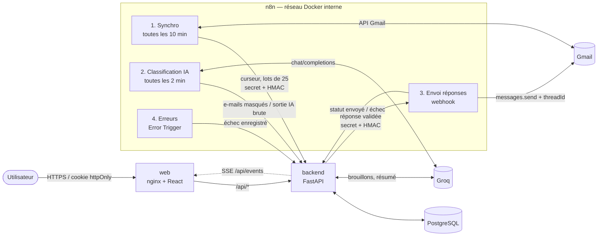
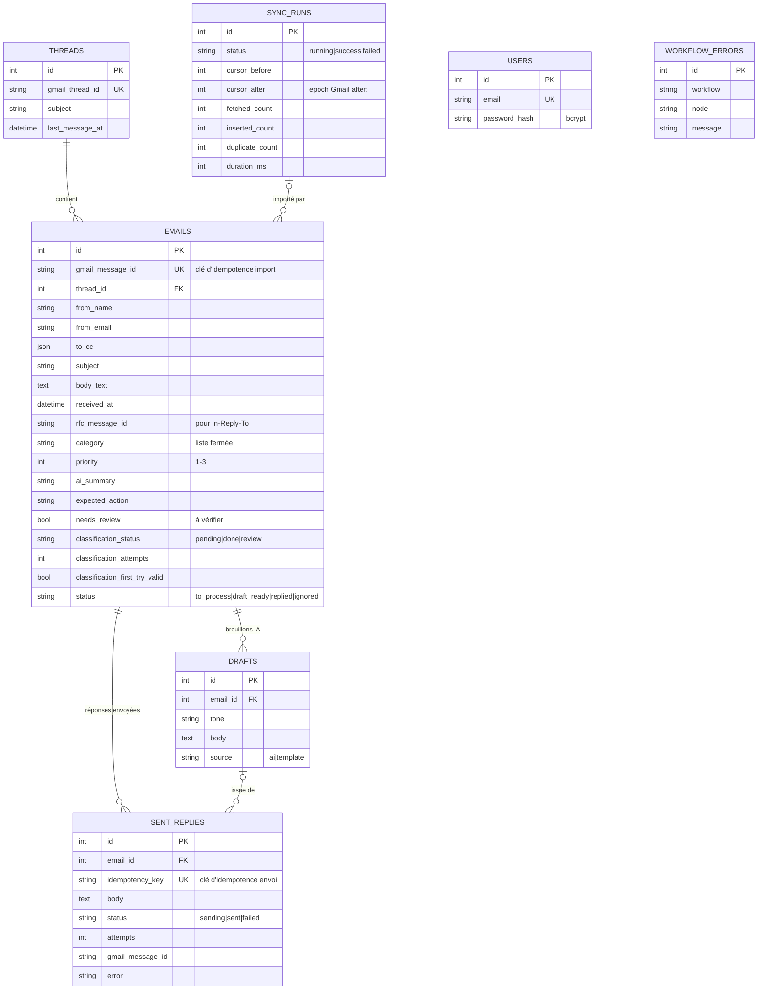

# Courrier — Assistant de boîte mail (Web, API & n8n)

Boîte de réception augmentée : synchronisation incrémentale de Gmail par **n8n**, classification par **IA** (Groq), bloc « Aujourd'hui », brouillons de réponse rédigés par l'IA et **envoyés uniquement après validation**, dans le bon fil Gmail.

| Brique | Techno | Rôle |
|---|---|---|
| `frontend/` | React 18 + TypeScript + Vite, servi par nginx | Interface responsive (desktop / mobile), clair / sombre |
| `backend/` | Python 3.12, FastAPI, SQLAlchemy 2 | API REST documentée, base de données, sécurité, idempotence |
| base | PostgreSQL 16 (SQLite pour les tests) | e-mails, fils, brouillons, réponses, synchronisations, erreurs |
| `n8n/` | n8n 1.110 self-hosted | 4 workflows : synchro, classification IA, envoi, erreurs |

---

## 1. Installation (depuis un dépôt vierge)

Prérequis : Docker Desktop (ou Docker Engine + Compose v2). Rien d'autre.

```bash
git clone <ce dépôt> && cd <ce dépôt>
cp .env.example .env
# Remplacer chaque "change-me" par un secret, par ex. :
python -c "import secrets; print(secrets.token_urlsafe(32))"
docker compose up -d --build
docker compose exec backend python scripts/seed_demo.py      # ~30 e-mails fictifs
```

- Interface : <http://localhost:8080> (identifiants `ADMIN_EMAIL` / `ADMIN_PASSWORD` du `.env`).
- Documentation de l'API (OpenAPI / Swagger) : <http://localhost:8080/api/docs>.
- n8n : <http://localhost:5678> (créer le compte propriétaire au premier lancement).

Au premier démarrage, le service `n8n-import` importe les 4 workflows et active « Classification » et « Envoi ». Il ne s'exécute qu'**une seule fois** (fichier témoin dans le volume) pour ne jamais écraser vos réglages ensuite.

### Mode démo (sans Gmail)

Le script de démo injecte les e-mails **par les mêmes webhooks signés que n8n**. Par défaut il joue aussi le rôle de l'IA (sorties pré-écrites, dont 2 invalides pour montrer la nouvelle tentative et le repli « à vérifier »). Avec `--no-labels`, les e-mails restent « en attente » et c'est le workflow n8n + Groq qui les classe.

Avec `REPLY_TRANSPORT=mock`, l'envoi est simulé. Pour tester l'échec et le bouton « Réessayer », mettez `[test-echec]` dans le corps de la réponse : le premier essai échoue, le second réussit.

### Brancher Gmail et l'IA

1. **Groq** : créer une clé gratuite sur <https://console.groq.com/keys>, la mettre dans `GROQ_API_KEY`, puis `docker compose up -d`.
2. **Gmail** (compte de test) : dans Google Cloud Console, activer l'API Gmail, créer un client OAuth « Application Web » avec l'URI de redirection `http://localhost:5678/rest/oauth2-credential/callback`.
3. Dans n8n : *Credentials → Gmail OAuth2 API*, coller l'ID et le secret, se connecter.
4. Sélectionner ce credential sur les nœuds **Gmail : lister les messages**, **Gmail : lire le message** (workflow 1) et **Gmail : envoyer dans le fil** (workflow 3).
5. Activer le workflow **1. Synchronisation Gmail** et passer `REPLY_TRANSPORT=n8n` dans `.env` (`docker compose up -d`).

### Tests

```bash
docker compose exec backend python -m pytest -q
# ou en local : cd backend && pip install -r requirements-dev.txt && pytest -q
```

43 tests, dont ceux demandés :

| Exigence | Tests |
|---|---|
| Import du même e-mail deux fois | `test_ingest.py::test_same_email_imported_twice_is_stored_once`, `test_duplicate_inside_the_same_batch` |
| Envoi de la même réponse deux fois | `test_replies.py::test_same_reply_sent_twice_goes_out_once`, `test_retry_only_from_failed_and_only_once`, `test_sent_callback_is_final_and_marks_email_replied` |
| Webhook sans secret / secret erroné | `test_security.py::test_webhook_without_secret_is_rejected`, `test_webhook_with_wrong_secret_is_rejected`, `test_webhook_with_tampered_body_is_rejected` |
| Sortie IA valide / invalide | `test_classification.py` (parseur + politique complète : ok, nouvelle tentative, repli « autre / à vérifier ») |

Également couverts : curseur de synchronisation, masquage téléphone / IBAN, accès refusé sans connexion, mot de passe haché, cookie `httpOnly`.

---

## 2. Architecture



Règle structurante : **le site ne parle jamais à n8n**. nginx ne relaie que `/api/*` vers le backend et renvoie 404 sur `/api/webhooks/*` ; ces routes ne sont joignables que depuis le réseau Docker (n8n). Le backend n'est pas publié sur l'hôte.

### Flux principaux

- **Synchronisation** : n8n demande au backend un *run* (`POST /sync-runs`) qui renvoie la requête Gmail (`in:inbox category:primary after:<curseur>`, 2 derniers jours au premier passage), liste les messages avec pagination (`nextPageToken`), demande au backend lesquels sont déjà importés, lit uniquement les nouveaux (1 toutes les 1,1 s, quota Gmail), extrait les champs et envoie des lots de 25 (`POST /emails`). À la fin, `POST /sync-runs/{id}/finish` : le curseur n'avance **que si le run a réussi**.
- **Classification** : n8n récupère les e-mails en attente (contenu **déjà masqué** par le backend), appelle Groq **un par un** avec une pause de 2 s, et transmet la **sortie brute** au backend, qui la valide et répond `ok`, `retry` ou `fallback`.
- **Réponse** : l'utilisateur demande un brouillon (ton formel / neutre / court), le modifie, puis confirme dans une boîte de dialogue. Le backend crée la réponse (clé d'idempotence) et déclenche le workflow d'envoi ; n8n répond 202, envoie dans le fil (`threadId` + `In-Reply-To` + `References`) et rappelle le backend avec le statut. L'interface suit l'état en temps réel : *en cours*, *envoyé*, *échec* + « Réessayer ».

### Modèle de données



### Routes REST (extrait — documentation complète sur `/api/docs`)

| Méthode | Route | Rôle |
|---|---|---|
| POST | `/api/auth/login`, `/api/auth/logout` · GET `/api/auth/me` | Session (cookie `httpOnly`, `SameSite=Strict`) |
| GET | `/api/emails?category=&priority=&status=&sender=&date_from=&date_to=&q=&needs_review=&page=` | Liste filtrable (filtres combinables, multi-valeurs) et paginée |
| GET | `/api/emails/counts`, `/api/emails/senders` | Compteurs de la barre latérale, expéditeurs fréquents |
| GET / PATCH | `/api/emails/{id}` | Détail, changement de statut (ignorer / remettre à traiter) |
| GET | `/api/threads/{id}` | Fil complet ordonné (messages reçus + réponses envoyées) |
| GET | `/api/summary?date=YYYY-MM-DD` | Bloc « Aujourd'hui » : chiffres, résumé, 5 priorités avec raisons |
| POST | `/api/emails/{id}/draft` | Brouillon IA (`{"tone": "formel" \| "neutre" \| "court"}`) |
| POST | `/api/emails/{id}/reply` + en-tête `Idempotency-Key` | Envoi validé par l'utilisateur (202) ; rejoué → même réponse (200) |
| POST | `/api/replies/{id}/retry` | Réessayer, uniquement depuis l'état `failed` (sinon 409) |
| GET | `/api/events` | Flux temps réel (Server-Sent Events) |
| GET | `/api/stats` | Mesures : synchros, taux de sorties IA valides, erreurs |
| POST | `/api/webhooks/n8n/sync-runs` · `/sync-runs/{id}/finish` | Curseur de synchronisation |
| POST | `/api/webhooks/n8n/emails` | Import par lot (idempotent) |
| POST | `/api/webhooks/n8n/emails/unknown` | Parmi des identifiants Gmail, ceux qui ne sont pas encore importés |
| GET / POST | `/api/webhooks/n8n/classification/pending` · `/classification` | File de classification, validation de la sortie IA |
| POST | `/api/webhooks/n8n/replies/{id}/status` · `/errors` | Statut d'envoi, erreurs de workflow |

---

## 3. Choix techniques et raisons

- **FastAPI** : validation stricte des entrées par Pydantic (la même brique valide la sortie de l'IA), documentation OpenAPI générée automatiquement, tests simples avec `TestClient`.
- **PostgreSQL en Docker, SQLite pour les tests** : PostgreSQL gère bien les écritures concurrentes (n8n + utilisateur), SQLite rend les tests instantanés. SQLAlchemy permet d'utiliser l'un ou l'autre sans changer de code.
- **L'idempotence repose sur la base, pas sur le code** : contraintes `UNIQUE` sur `gmail_message_id` et `idempotency_key`. Même deux requêtes simultanées ne peuvent pas créer deux lignes ; l'`IntegrityError` est rattrapée (savepoint) et traitée comme un doublon.
- **« Réessayer » est une mise à jour conditionnelle** (`UPDATE … SET status='sending' WHERE id=? AND status='failed'`) : deux clics simultanés ne déclenchent qu'un seul envoi, et on ne peut pas relancer une réponse encore « en cours » ou déjà « envoyée ». Un rappel tardif de n8n ne peut pas faire repasser une réponse envoyée en échec.
- **La validation de la sortie IA est dans le backend**, pas dans n8n : la règle (liste fermée, priorité entière 1-3, champs obligatoires, une seule nouvelle tentative puis repli) est testée unitairement et n8n reste un orchestrateur. n8n demande en plus `response_format: json_object` à Groq.
- **Curseur = début de la dernière synchro réussie, moins 5 min de recouvrement** : aucun message arrivé pendant une synchro n'est perdu ; les relectures sont absorbées par l'idempotence. Une synchro en échec (nœud en erreur → workflow d'erreur) est marquée `failed` et ne fait pas avancer le curseur.
- **Workflows séparés** (synchro / classification / envoi / erreurs) : rythmes différents (10 min, 2 min, à la demande), un quota IA dépassé ne bloque pas l'import, et l'envoi n'est déclenché que par le backend.
- **Limites du fournisseur d'IA** : un appel à la fois, 2 s entre deux appels, 3 essais espacés de 5 s sur erreur, puis pause de 60 s et passage à l'e-mail suivant (celui-ci reste « en attente » et sera repris au passage suivant). Côté backend, les appels Groq respectent l'en-tête `Retry-After` sur un 429.
- **Brouillons générés par le backend** (et non par n8n) : l'utilisateur attend la réponse dans l'interface, un aller-retour synchrone est plus simple et plus fiable. Sans clé IA, un modèle de réponse par ton prend le relais (signalé dans l'interface).
- **Top 5 « Aujourd'hui » déterministe** : un score explicable (priorité IA, catégorie, ancienneté, « à vérifier », brouillon déjà prêt) dont chaque point est affiché comme raison. Le résumé global est rédigé par l'IA si une clé est fournie (mis en cache), sinon généré à partir des chiffres.
- **Interface** : React sans bibliothèque de routage ni de gestion d'état (peu d'écrans), CSS écrit à la main avec des variables (thèmes clair / sombre), polices auto-hébergées (Inter, Instrument Serif). Trois colonnes sur desktop, tiroir + vue liste / fil sur mobile.

## 4. Sécurité

- Aucune donnée sans authentification : toutes les routes utilisateur exigent le cookie de session (JWT HS256 signé, `httpOnly`, `SameSite=Strict`, `Secure` configurable). Limitation des tentatives de connexion (10 / 5 min / IP).
- Mots de passe hachés avec **bcrypt** (coût 12) ; le compte admin est créé au démarrage à partir des variables d'environnement.
- **Webhooks n8n → backend** : secret partagé dans `X-Webhook-Secret` (comparaison à temps constant) **et** signature **HMAC-SHA256** du corps brut dans `X-Signature` (`WEBHOOK_HMAC_REQUIRED=true`). Sinon : 401.
- **Backend → n8n** : même schéma ; le workflow d'envoi vérifie secret et signature avant tout envoi et répond 401 sinon.
- Secrets uniquement dans `.env` (ignoré par git). Les exports n8n ne contiennent **aucun identifiant** : les workflows lisent `$env.WEBHOOK_SECRET` / `$env.GROQ_API_KEY`, et le credential Gmail est créé dans n8n, chiffré par `N8N_ENCRYPTION_KEY`.
- Logs : pas d'access log (les chaînes de requête contiennent recherches et adresses), aucun corps ni secret journalisé.
- **Masquage** des numéros de téléphone et des IBAN avant tout envoi de contenu à l'IA (classification, brouillons).

## 5. Difficultés rencontrées et solutions

| Difficulté | Solution |
|---|---|
| Vérifier une signature HMAC dans n8n alors que le webhook fournit un corps déjà *parsé* | Le backend signe un JSON **compact** (`separators=(",", ":")`, `ensure_ascii=False`), identique à `JSON.stringify` du corps parsé côté n8n. |
| Un GET n'a pas de corps à signer (file de classification) | Le secret suffit pour les GET ; l'HMAC est exigé sur toute requête avec corps. |
| Les workflows importés écrasaient le credential Gmail choisi à chaque redémarrage | Import unique, protégé par un fichier témoin dans le volume n8n. |
| Le montage de dossier (`./n8n/workflows:/workflows`) apparaissait vide selon l'emplacement du projet sur Windows | Les exports sont copiés dans une image n8n dérivée (`n8n/Dockerfile`) : plus de dépendance au système de fichiers de l'hôte. |
| Une réponse pouvait rester « en cours » si n8n plante sans rappeler | Passage automatique en « échec (délai dépassé) » après 10 min, ce qui rend « Réessayer » possible. |
| Temps réel derrière nginx (le SSE était bufferisé) | `proxy_buffering off` sur `/api/events` + `X-Accel-Buffering: no` + commentaire keep-alive toutes les 15 s. Repli : interrogation toutes les 2 s tant qu'une réponse est « en cours ». |
| Import en parallèle de plusieurs lots partageant les mêmes fils : *deadlock* PostgreSQL | Verrou consultatif PostgreSQL (`pg_advisory_xact_lock`) qui sérialise les imports, création de fil tolérante aux doublons, et envoi des lots un par un dans n8n. Vérifié avec 7 lots simultanés. |
| Quota Gmail « Units per minute per user » dépassé (erreur 403 affichée comme « Forbidden ») au premier import (598 messages) | Requête limitée à l'onglet Principale et aux 2 derniers jours au premier passage ; n8n demande d'abord au backend les messages **déjà importés** (`POST /emails/unknown`) et ne lit que les nouveaux, lentement (1 / 1,1 s) ; un message refusé n'arrête pas la synchro : le run est marqué en échec, le curseur ne bouge pas et seuls les manquants sont relus au passage suivant. |
| Données Gmail réelles : caractères NUL, objets très longs | Nettoyage avant insertion (test dédié). |
| Le modèle Groq prévu (`llama-3.1-8b-instant`) a été **retiré** par Groq : chaque appel renvoyait `model_not_found` et la classification tournait en boucle sur la pause de 60 s | Diagnostic en rejouant la requête du workflow, comparaison des modèles disponibles sur de vrais e-mails, passage à `qwen/qwen3.8-27b` (meilleur tri, ~0,5 s). Le modèle est une variable d'environnement (`GROQ_MODEL`) : il se change sans toucher au code. |
| Sorties IA « presque » JSON (bloc ```json) | Le parseur accepte uniquement un objet JSON, éventuellement entouré d'un bloc de code ; tout le reste est invalide et suit la politique nouvelle tentative / repli. |

## 6. Résultats mesurés

Mesures prises sur la pile Docker de ce dépôt (Windows 11, Docker Desktop, PostgreSQL), avec un compte Gmail de test et une clé Groq (modèle `qwen/qwen3.8-27b`).

### Les deux chiffres demandés

| Mesure | Résultat | Méthode |
|---|---|---|
| **Durée de synchronisation de 30 e-mails** (Gmail → n8n → backend) | **≈ 34 s** (1,13 s par e-mail) | Run de synchro réel n° 6 : 158 messages listés, **79 nouveaux lus et enregistrés en 89,1 s** (les autres, déjà importés, ont été ignorés sans relecture). 30 × 1,13 s ≈ 34 s. Le temps est dominé par la lecture volontairement ralentie (1 message / 1,1 s) pour respecter le quota Gmail d'un projet de test. |
| **Part des sorties IA valides du premier coup, jeu de démonstration** | **30 / 30 (100 %)** | `scripts/measure_ai.py` : les 30 e-mails de démo envoyés à Groq avec **exactement** la requête du workflow n8n (prompt lu dans l'export) et validés par le parseur du backend. Catégorie identique à l'étiquette attendue : **28 / 30 (93 %)** ; latence médiane **0,67 s**. |

Sur de **vrais e-mails** Gmail (classés par le workflow n8n) : **35 / 35 sorties valides du premier coup**, visibles dans `GET /api/stats` → `classification.first_try_valid_rate`. Les deux écarts de catégorie sur la démo sont défendables (une notification URSSAF classée « facture », un bon de commande signé classé « client »).

Pour refaire la mesure IA :

```bash
cd backend && GROQ_API_KEY=... python scripts/measure_ai.py --workflow ../n8n/workflows/2-classification-ia.json
```

### Autres mesures

| Mesure | Résultat | Méthode |
|---|---|---|
| Import de 30 e-mails de démo (3 lots de 10, signés HMAC, insertion PostgreSQL) | **158 ms** | `seed_demo.py`, run de synchro `demo` |
| Ré-import des mêmes 30 e-mails | **72 ms**, 0 insérés, 30 doublons ignorés | idem, second lancement |
| 7 lots de 25 e-mails envoyés **en parallèle** sur les mêmes fils | 7 × HTTP 200, 0 doublon, 0 *deadlock* | script de charge sur la pile Docker |
| Aller-retour d'envoi backend → n8n (vérification HMAC, MIME) → backend | statut renvoyé en moins de 6 s | `REPLY_TRANSPORT=n8n` |
| Webhook falsifié vers n8n / webhook via le site public / API sans session | 401 / 404 / 401 | `curl` |
| Tests automatisés | **43 / 43** | `pytest` (local et dans le conteneur) |

## 7. Limites et améliorations possibles

- Un seul utilisateur et une seule boîte Gmail ; pas de rôles.
- Synchronisation par requête `after:` : l'API Gmail `history.list` (`historyId`) serait plus précise et détecterait aussi suppressions et changements de libellés.
- Le bus d'événements SSE est en mémoire : pour plusieurs instances du backend, passer par PostgreSQL `LISTEN/NOTIFY` ou Redis.
- Gmail n'est pas idempotent : si n8n envoie le message mais plante avant de rappeler le backend, un « Réessayer » après le délai de 10 min pourrait produire un doublon. Amélioration : rechercher dans le fil un message portant un en-tête `X-Reply-Id` avant de renvoyer.
- Débit IA du palier gratuit Groq : ~5 classifications par minute sur de longs e-mails ; un premier import de 160 e-mails demande ~30 min de classification (le site reste utilisable, les e-mails s'affichent « Classement… » en attendant).
- La boucle d'envoi réel (n8n → Gmail `messages.send` avec `threadId`) est en place et vérifiée jusqu'à l'appel Gmail ; elle n'a pas fait l'objet d'une mesure dédiée.
- Pas encore de migrations versionnées (Alembic) : le schéma est créé au démarrage.
- La recherche utilise `LIKE` ; au-delà de quelques dizaines de milliers d'e-mails, passer à la recherche plein texte PostgreSQL (`tsvector`).
- Bonus non réalisé : règle de réponse automatique sans validation pour une catégorie.

## Bonus réalisés

- Mise à jour en temps réel sans rechargement (**Server-Sent Events**).
- **Signature HMAC** du corps des webhooks, dans les deux sens, en plus du secret partagé.
- **Masquage des numéros de téléphone et des IBAN** avant l'envoi à l'IA (testé).

## Arborescence

```
backend/            API FastAPI, tests (pytest), script et données de démo
  app/routers/      auth, emails/threads/summary, webhooks n8n, events/stats
  app/services/     ingest, classification, replies, summary, ai, masking, events
  scripts/          seed_demo.py + demo_emails.json (30 e-mails fictifs)
frontend/           React + TypeScript (Vite), nginx.conf
n8n/workflows/      exports JSON des 4 workflows
docker-compose.yml  db, backend, web, n8n-import, n8n
.env.example
```
